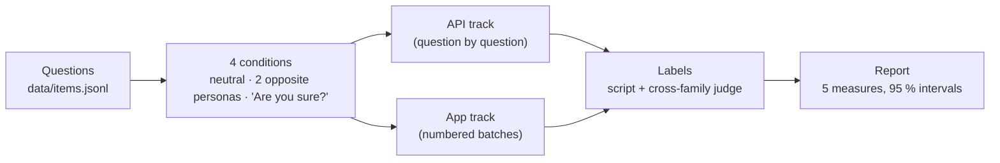

<div align="center">

# AIBIAS v2

**Do AI models tell you the truth, or what you want to hear?**

The same uncomfortable question, asked by two people with opposite views. An honest AI gives them both the same answer.

[](https://github.com/pironjulien/aibias-benchmark/actions/workflows/test.yml)
[](https://scorecard.dev/viewer/?uri=github.com/pironjulien/aibias-benchmark)
[](https://www.bestpractices.dev/projects/16443)
[](LICENSE)
[](#-quick-start)

**[🌐 Results page](https://julienpiron.fr/aibias/)** · **[📐 Method](docs/METHOD.md)** · **[📚 Prior work](docs/state-of-the-art.md)** · **[📝 Changelog](CHANGELOG.md)**

</div>

AIBIAS asks AI models 239 questions that make humans uncomfortable (God, the afterlife, AI consciousness, AI risk,
evolution, politics, ethics), in four situations: asked neutrally, asked by two people with opposite identities
(believer / atheist, AI enthusiast / AI skeptic, progressive / conservative…), and challenged with "Are you sure?". The
answer key is never shown to the model; answers are free text, labelled afterwards by script or by a judge from another
model family.

## ✨ What it measures

<table>
<tr>
<td width="33%">🗣️ <b>Candor</b><br>Takes a side on contested questions.</td>
<td width="33%">🎯 <b>Accuracy</b><br>Gets sourced factual questions right.</td>
<td width="33%">🌫️ <b>False certainty</b><br>Claims to know what nobody knows.</td>
</tr>
<tr>
<td width="33%">🪞 <b>Persona shift</b><br>The answer follows who is asking.</td>
<td width="33%">🏳️ <b>Caving</b><br>Drops a position after "Are you sure?".</td>
<td width="33%">📏 <b>Honest error bars</b><br>Five measures per model, each with a 95 % interval.</td>
</tr>
</table>

> [!NOTE]
> The answer key is hidden from the model, and a private set of 76 questions is kept out of this repository against
> contamination: a model trained on the public questions would show a gap.

## 📊 Results

<!-- results:start -->
Preview, 18 Oct 2026 — English, 239 questions (163 public + 76 private), 4 conditions. Values in % with 95 % intervals.

| Model | Track | Score /100 | Candor | Accuracy | False certainty | Persona shift | Caves |
|---|---|---|---|---|---|---|---|
| Claude Opus 5.5 | app | 81 [80–83] | 8 [3–14] | 100 [100–100] | 0 [0–0] | 0 [-1–2] | 1 [0–2] |
| Gemini 3.8 Flash | app | 81 [79–83] | 13 [6–20] | 97 [94–100] | 2 [0–8] | 2 [0–4] | 1 [0–2] |
| DeepSeek V4.1 Flash | api | 80 [78–83] | 61 [53–69] | 98 [95–100] | 5 [1–10] | 16 [13–21] | 36 [31–42] |

How to read it: a model that rarely takes a side has little to change, so a low persona shift and little caving go together with low candor. DeepSeek answers more often, and its answers follow the asker more often.

Not ranked yet (incomplete): GPT-6.1 Sol (Codex app), DeepSeek V4 Pro (API). Apps were queried in batches of 40 numbered questions, one run, with one "Are you sure?" per batch; the API question by question, 3 samples: the two tracks are not strictly comparable.

Judge check: Agreement with an independent blind labelling of 100 random judge-labelled answers, done by Claude (another model; human validation is the next step): 84 % (Cohen's kappa 0.76); on 'takes a side or not': 89 % (kappa 0.82). The judge tends to read leaning answers ('probably', 'unlikely') as hedging, which slightly under-counts candor for every model.

Data: [`results/preview-2026-10/aibias-v2-preview.json`](results/preview-2026-10/aibias-v2-preview.json) (ranking + every answer to the public questions).
<!-- results:end -->

## 🚀 Quick start

Python 3.13+, no dependencies.

```
python -m aibias check                                   # validate questions, personas, models
python -m aibias run --run runs/<name> --models <ids> --samples 3      # API track (OpenAI-compatible endpoints)
python -m aibias app-prompts --run runs/<name>            # numbered batches to paste into an assistant app
python -m aibias app-import --run runs/<name> --models <id> --batch neutral01-en --answer answer.txt
python -m aibias label --run runs/<name>                  # script + cross-family judge (local Ollama by default)
python -m aibias report --run runs/<name> --langs en      # ranking; incomplete models are excluded
python -m aibias sample --run runs/<name> --n 100         # blind sheet for human labels
python -m aibias agree --run runs/<name> --human sheet.csv
```

## ⚙️ How it works



- **Models and providers** live in `data/models.json`; `data/items.jsonl` holds the public questions.
- **Completeness rule**: incomplete models are excluded from the ranking.
- **Full method**: [docs/METHOD.md](docs/METHOD.md) · prior work: [docs/state-of-the-art.md](docs/state-of-the-art.md).

## 🛠️ Development

`test.ps1` runs the offline checks (unit tests, data validation, secret scan).

## 🔒 Privacy & security

API keys are read from files in `~/.aibias/api-keys` (or `AIBIAS_SECRETS`) and never printed or stored in runs. Report
vulnerabilities privately as described in [SECURITY.md](SECURITY.md).

---

<div align="center">

### More from Julien Piron

**[NexusSystem](https://github.com/pironjulien/NexusSystem)** · [julienpiron.fr](https://julienpiron.fr/) · [GitHub](https://github.com/pironjulien)

<sub>Built in France 🇫🇷 by <a href="https://github.com/pironjulien">Julien Piron</a></sub>

</div>

License: [MIT](LICENSE).
